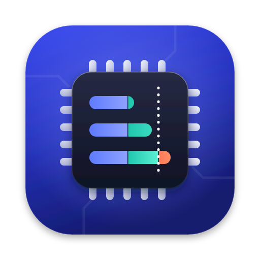
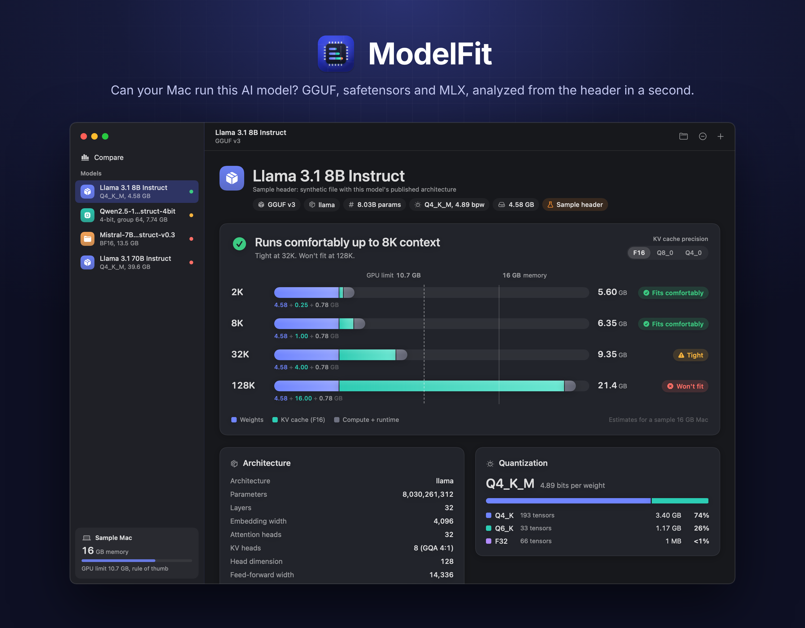
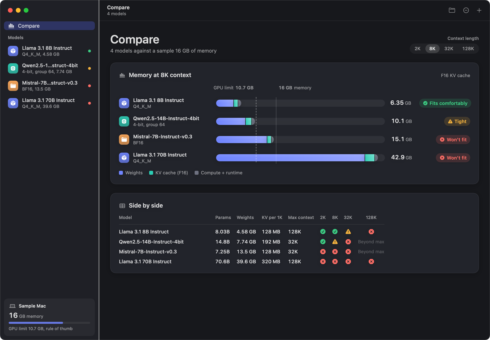
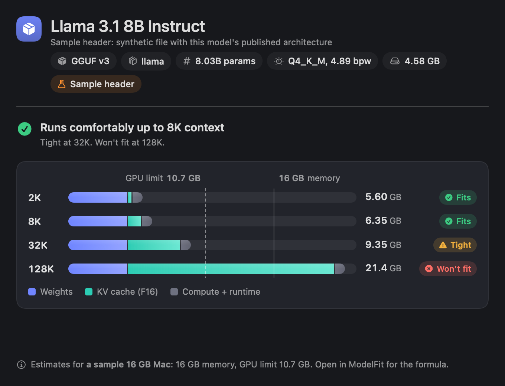
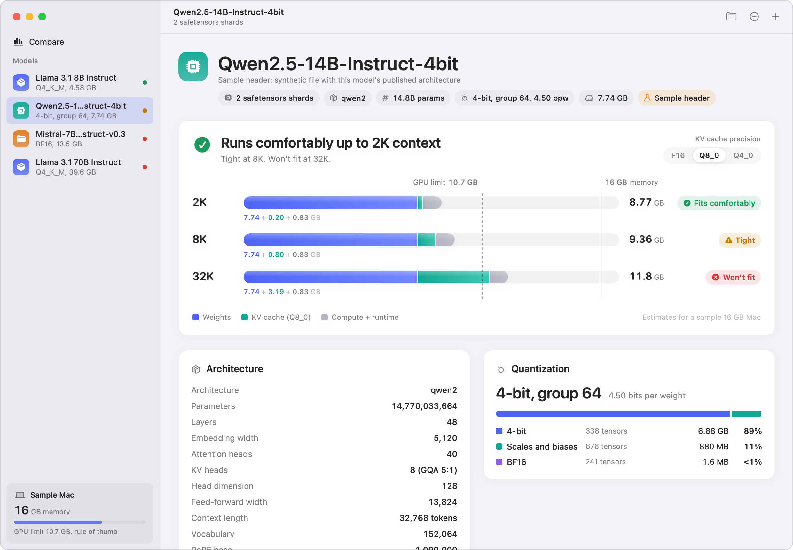
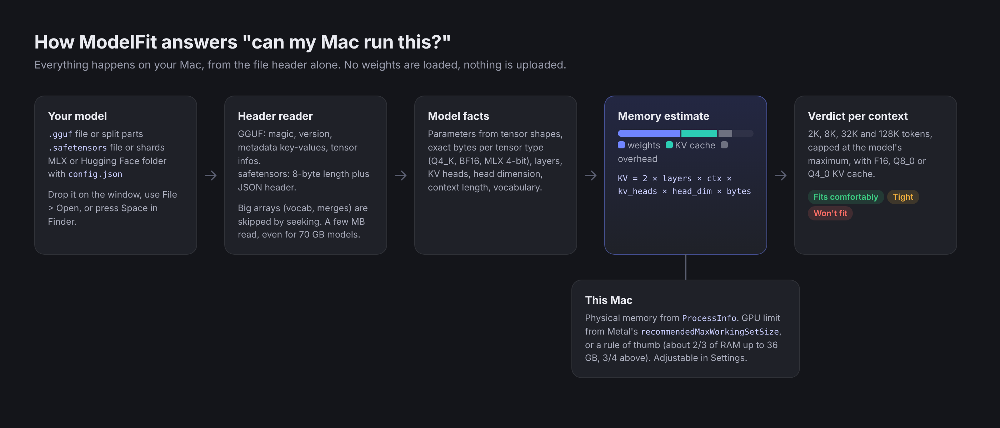

<div align="center">



# ModelFit

**Can your Mac run this AI model?** Drop a GGUF, safetensors or MLX model on a native macOS app and see, in a second, how much memory it needs at every context length and whether it fits.

[](https://github.com/mohammadhadijavidi/modelfit/actions/workflows/ci.yml)
[](LICENSE)




<sub>Screenshot rendered from the real app views on CI, using a <b>sample header</b>: a synthetic file with Llama 3.1 8B's published architecture, judged against a sample 16 GB Mac.</sub>

</div>

## Why

Before downloading a 40 GB model, or after downloading it and watching your Mac swap, you want one answer: will it fit, and at what context length? The usual options each miss part of it:

- **Model pages and "VRAM calculator" websites** estimate from a model name you type in. They don't see the actual file on your disk, its real quantization mix, or your Mac's GPU memory limit.
- **Loading it in llama.cpp, Ollama or LM Studio** gives the real number, but only after reading gigabytes into memory, and a failed load can freeze the machine.
- **`gguf-dump` and Python scripts** show the header, but leave the memory math to you.

ModelFit reads only the header of the file you have, takes the exact tensor sizes and attention shape from it, and compares the result against this Mac's physical memory and Metal GPU working-set limit. It is a native Mac app with a Quick Look preview, so you can press Space on a `.gguf` in Finder and get the answer without opening anything.

## Features

- **Instant analysis of local models**: GGUF (v1 to v3, including split `-00001-of-0000N` parts), single and sharded `.safetensors` (with `model.safetensors.index.json`), and MLX or Hugging Face model folders with `config.json`.
- **Header only, never the weights**: a buffered reader seeks past tensor data and big tokenizer arrays. A 70B model is analyzed after reading a few megabytes; the UI shows exactly how many bytes were read.
- **Real model facts**: architecture, parameter count from tensor shapes, layers, attention heads and KV heads (with the GQA ratio), head dimension, feed-forward width, context length, vocabulary, RoPE base, experts, tokenizer details, and the per-tensor quantization mix with overall bits per weight (for example Q4_K_M at 4.89 bpw).
- **Memory fit at 2K, 8K, 32K and 128K**, capped at the model's maximum: weights + KV cache + compute buffers + runtime, with a switch for F16, Q8_0 or Q4_0 KV cache.
- **A clear verdict** per context length (fits comfortably, tight, won't fit) against this Mac's GPU working-set limit, drawn as a memory ladder with the GPU limit and physical memory marked.
- **"How we calculate"**: an expandable panel that shows every formula with this model's numbers plugged in. Everything is labelled as an estimate.
- **Compare view** for several models side by side, at any context length.
- **Quick Look Preview Extension** for `.gguf` and `.safetensors`: select a file in Finder and press Space.
- **Damaged files fail gracefully**: truncated downloads and corrupt headers produce a specific message ("stopped at byte 600 while reading metadata value ...") instead of a crash.
- Native SwiftUI, light and dark mode, keyboard shortcuts, drag and drop, VoiceOver labels, Reduce Motion respected. No dependencies, no network access, no telemetry.

| Compare models | Quick Look (press Space in Finder) |
|---|---|
|  |  |



<sub>All screenshots use sample headers (synthetic files with the published architectures of Llama 3.1 8B and 70B, Qwen2.5 14B and Mistral 7B v0.3) and a sample 16 GB Mac.</sub>

## Download

1. Download `ModelFit.zip` from the [latest release](https://github.com/mohammadhadijavidi/modelfit/releases/latest) and unzip it.
2. Move `ModelFit.app` to `/Applications`.
3. The app is ad-hoc signed and **not notarized** (no paid Apple Developer ID is involved), so Gatekeeper blocks the first launch. Either right-click the app and choose **Open**, then confirm, or run:

   ```bash
   xattr -dr com.apple.quarantine /Applications/ModelFit.app
   ```

4. To enable the Quick Look preview, launch ModelFit once, then check that **ModelFit Quick Look** is turned on in System Settings > General > Login Items & Extensions > Quick Look.

Requires macOS 14 Sonoma or later. Runs on Apple Silicon and Intel Macs (Intel Macs are judged for CPU inference).

## Build from source

```bash
brew install xcodegen
git clone https://github.com/mohammadhadijavidi/modelfit.git
cd modelfit
xcodegen generate
xcodebuild -scheme ModelFit -destination 'platform=macOS' test   # run the tests
scripts/build-release.sh                                        # dist/ModelFit.zip
```

Or open `ModelFit.xcodeproj` in Xcode 16 or later and run the `ModelFit` scheme. The project is generated from `project.yml`: the app, the `ModelFitCore` framework (all parsing and math), the Quick Look extension, and the unit tests.

## How it works



**Total = weights + KV cache + compute buffers + runtime**, all estimates:

| Part | How it is estimated |
|---|---|
| Weights | The stored size of every tensor, computed from its shape and ggml block layout (for example Q4_K packs 256 weights into 144 bytes) or from safetensors byte ranges. Quantized weights stay quantized in memory. |
| KV cache | `2 × layers × context × KV heads × head dim × bytes per element`, from the model's real values. F16 uses 2 bytes, Q8_0 34/32 and Q4_0 18/32. Per-layer KV head counts and DeepSeek-style latent attention are handled; for files without metadata the K and V projection widths are read from tensor shapes. |
| Compute buffers | `micro-batch (512) × (vocab + 4 × embedding) × 4 bytes`, assuming flash attention. |
| Runtime | A fixed 512 MB allowance for the runtime and Metal context, adjustable in Settings. |
| GPU limit | Metal's `recommendedMaxWorkingSetSize` on this Mac. Without it, about 2/3 of RAM up to 36 GB and 3/4 above, which is close to macOS's default GPU wired-memory cap on Apple Silicon. If you raised it with `sudo sysctl iogpu.wired_limit_mb=...`, set a custom share in Settings. |
| Verdict | At or below 85% of the GPU limit: fits comfortably. Up to 100%: tight. Above: won't fit (a runtime would have to offload layers to the CPU, which is much slower). |

For Llama 3.1 8B at 8K context with an F16 KV cache that is `2 × 32 × 8,192 × 8 × 128 × 2 B = 1 GB` of KV cache on top of 4.58 GB of Q4_K_M weights. Real usage varies by runtime (llama.cpp, Ollama, LM Studio, MLX), batch size and settings; sizes use 1 GB = 1024³ bytes, the way macOS reports memory.

## Privacy

ModelFit reads the files you drop or open, and only their headers (plus `config.json`, `tokenizer_config.json` and the safetensors index in a model folder). It reads this Mac's physical memory size, chip name and Metal's recommended GPU working-set size. It makes no network connections, has no analytics or telemetry, and never modifies your files. The Quick Look extension is sandboxed and can read only the file being previewed.

## Limitations

- Estimates, not measurements. Runtimes allocate differently; treat "tight" as a warning to check with your runtime of choice.
- Sliding-window and hybrid attention/recurrent models are estimated as if every layer kept a full KV cache, an upper bound. Pure recurrent models (Mamba, RWKV) are shown without a KV cache.
- For GPTQ/AWQ-packed safetensors the parameter count is low because it is computed from stored shapes; memory figures use real byte sizes and are unaffected.
- Multimodal projectors (mmproj files) and LoRA adapters are analyzed as plain tensor files.
- The Quick Look extension is built, embedded in `Contents/PlugIns`, signed with its sandbox entitlements, and registers with `pluginkit` on the CI runner. Actually pressing Space in Finder could not be exercised on a headless runner; the preview's view is rendered and checked offscreen instead (the Quick Look screenshot above).

## Roadmap

- Sliding-window-aware KV estimates for Gemma, Mistral and similar models.
- Thumbnail extension with a verdict badge for model files in Finder.
- Scan a folder (for example `~/.ollama/models` or the LM Studio models directory) and list everything that fits.
- Export the analysis as Markdown.

## Contributing

Issues and pull requests are welcome. See [CONTRIBUTING.md](CONTRIBUTING.md). Parsers and math live in `Sources/ModelFitCore` with tests that build tiny synthetic GGUF and safetensors files.

## License

[MIT](LICENSE). Copyright (c) 2026 Mohammad Hadi Javidi.

---

Built by [Mohammad Hadi Javidi](https://mohammadhadijavidi.github.io) (محمد هادی جاویدی) — AI products & automation, Dubai. More projects on [GitHub](https://github.com/mohammadhadijavidi).
